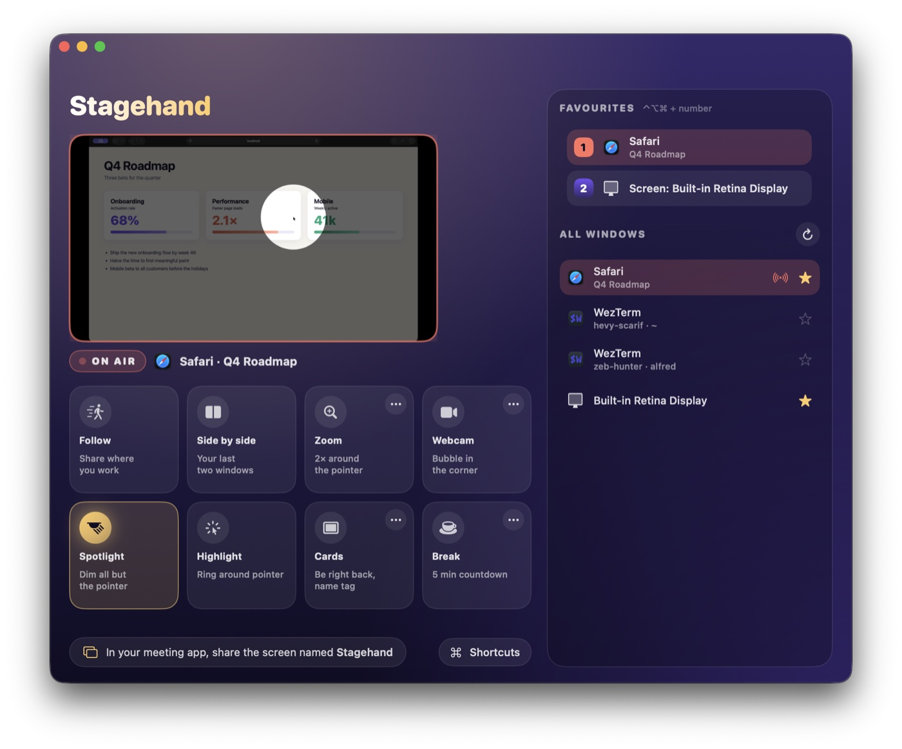
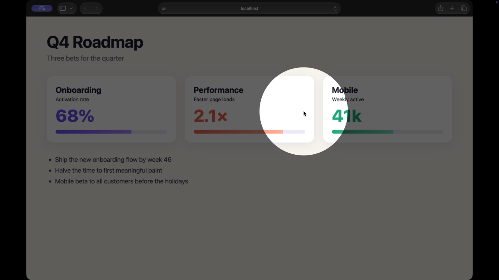

# Stagehand

Share one screen in Teams, Zoom, Meet or Slack, then change what it shows with a keystroke, without stopping the share.



## How it works

Stagehand creates a virtual display named **Stagehand**. Share that display once in your meeting app. Whatever you put on stage fills it: any window or a whole screen. The control panel shows a live preview of exactly what the meeting sees.

- **Favourites:** star the windows you present from and they get fixed shortcuts, ⌃⌥⌘1 to 9. Drag to reorder. They're remembered by app and window title, so they survive restarts.
- **Follow:** the stage shows whichever window you're working in. Meeting apps are ignored, so checking the chat doesn't switch what you share.
- **Focus:** picking a window also brings it to the front, so you work in the window everyone sees.
- **Side by side:** two windows on stage at once, your last two picks. Right-click a window to put it on the right.
- **Zoom:** magnify the area around the pointer (1.5× to 4×) for small text; the view glides along with the pointer.
- **Webcam:** a bubble in any corner, three sizes, circle or rounded square, or full screen ("Just me"). Background blur and Studio Light come from macOS's own camera effects.
- **Pointer effects:** a spotlight that dims everything except the area around the pointer, and a highlight ring.
- **Title cards:** "Be right back", "Starting soon" with a countdown to a set time, a break countdown, and a name tag with your name and role.
- **On / off:** turn Stagehand off between meetings (⌃⌥⌘O, the power button in the panel, or the menu bar). Off means nothing is captured and the Stagehand screen disappears, so macOS stops saying your screen is being recorded. It also turns off by itself when the screen locks (you can change that). Picking a window turns it back on.
- **Updates:** Stagehand checks for new versions once a day and updates itself.



## Install

Download the latest **Stagehand-x.y.z.zip** from [Releases](https://github.com/maxflach/stagehand/releases/latest), unzip it and move Stagehand to Applications. It's signed and notarized, so it opens normally.

On first launch, allow **Screen Recording**, then reopen the app. Optional: **Accessibility** (to bring picked windows to the front) and **Camera** (webcam bubble).

## Shortcuts

These are the defaults. To change one, click **Shortcuts** in the control panel, click the shortcut and press the new keys. Delete removes a shortcut, **Reset to defaults** brings them all back.

| Keys | Action |
|---|---|
| ⌃⌥⌘1 … 9 | Show favourite 1 to 9 (window list order if you have none) |
| ⌃⌥⌘← / → | Previous / next favourite |
| ⌃⌥⌘O | Stagehand on / off |
| ⌃⌥⌘D | Side by side on / off |
| ⌃⌥⌘F | Follow mode on / off |
| ⌃⌥⌘Z | Zoom on / off |
| ⌃⌥⌘= / - | Zoom in / out |
| ⌃⌥⌘S | Spotlight on / off |
| ⌃⌥⌘H | Highlight pointer on / off |
| ⌃⌥⌘C | Webcam on / off |
| ⌃⌥⌘J | Just me: webcam full screen |
| ⌃⌥⌘W | Be right back card |
| ⌃⌥⌘B | Start / stop break countdown |
| ⌃⌥⌘L | Name tag on / off |
| ⌃⌥⌘R | Refresh the window list |

## Build

```bash
./scripts/build.sh          # build/Stagehand.app, Developer ID signed (hardened runtime)
./scripts/release.sh        # + notarize, staple, zip and write the Sparkle appcast
```

Requires Xcode and macOS 14 or later.
