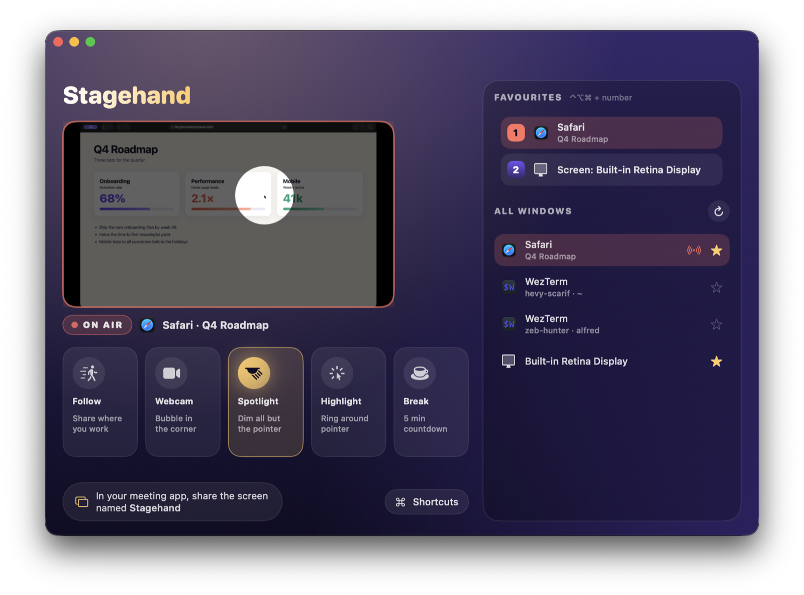

# Stagehand

Share one screen in Teams, Zoom, Meet or Slack, then change what it shows with a keystroke, without stopping the share.



## How it works

Stagehand creates a virtual display named **Stagehand**. Share that display once in your meeting app. Whatever you put on stage fills it: any window or a whole screen. The control panel shows a live preview of exactly what the meeting sees.

- **Favourites:** star the windows you present from and they get fixed shortcuts, ⌃⌥⌘1 to 9. Drag to reorder. They're remembered by app and window title, so they survive restarts.
- **Follow:** the stage shows whichever window you're working in. Meeting apps are ignored, so checking the chat doesn't switch what you share.
- **Focus:** picking a window also brings it to the front, so you work in the window everyone sees.
- **Overlays:** your webcam in a corner bubble, a spotlight that dims everything except the area around the pointer, a highlight ring around the pointer, and a full-screen break countdown.
- **Updates:** Stagehand checks for new versions once a day and updates itself.


## Install

Download the latest **Stagehand-x.y.z.zip** from [Releases](https://github.com/maxflach/stagehand/releases/latest), unzip it and move Stagehand to Applications. It's signed and notarized, so it opens normally.

On first launch, allow **Screen Recording**, then reopen the app. Optional: **Accessibility** (to bring picked windows to the front) and **Camera** (webcam bubble).

## Shortcuts

| Keys | Action |
|---|---|
| ⌃⌥⌘1 … 9 | Show favourite 1 to 9 (window list order if you have none) |
| ⌃⌥⌘← / → | Previous / next favourite |
| ⌃⌥⌘F | Follow mode on / off |
| ⌃⌥⌘C | Webcam on / off |
| ⌃⌥⌘S | Spotlight on / off |
| ⌃⌥⌘H | Highlight pointer on / off |
| ⌃⌥⌘B | Start / stop break countdown |
| ⌃⌥⌘R | Refresh the window list |

## Build

```bash
./scripts/build.sh          # build/Stagehand.app, Developer ID signed (hardened runtime)
./scripts/release.sh        # + notarize, staple, zip and write the Sparkle appcast
```

Requires Xcode and macOS 14 or later.
